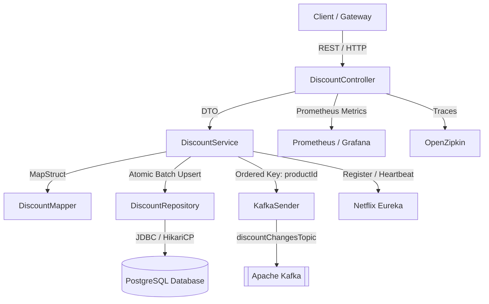

# 🏷️ Discount Service

[](https://github.com/serjnn/micr.DiscountService/actions)
[](https://opensource.org/licenses/Apache-2.0)
[](https://openjdk.org/)
[](https://spring.io/projects/spring-boot)

A high-performance, resilient microservice responsible for managing product discounts and broadcasting real-time changes to downstream services via Apache Kafka.

---

## 🏛️ Architecture & System Design



---

## 🚀 Key Features

- **Financial Decimal Precision**: Uses `BigDecimal` and PostgreSQL `NUMERIC(10, 2)` throughout all layers to avoid floating-point inaccuracies.
- **Ordered Kafka Streaming**: Uses `productId` as Kafka message key, guaranteeing strict partition-level ordering for each product.
- **Idempotent Kafka Producer**: Fully configured with `enable.idempotence=true`, `acks=all`, and bounded in-flight requests.
- **High-Performance Data Access**: PostgreSQL atomic `ON CONFLICT (product_id) DO UPDATE` batch upserts with tuned HikariCP connection pooling.
- **Standardized Error Handling**: RFC 7807 `ProblemDetail` responses for 400 (validation), 404 (not found), and 500 errors.
- **Object Mapping**: Clean compile-time code generation with MapStruct.
- **Interactive Documentation**: OpenAPI 3 / Swagger UI integrated out-of-the-box.
- **Enterprise Observability**: Distributed tracing with Micrometer Tracing & Zipkin, metrics via Prometheus, and Kubernetes liveness/readiness probes.
- **Production-Ready Containerization**: Hardened multi-stage non-root Dockerfile, `docker-compose.yml`, and Kubernetes manifests in `k8s/`.

---

## 📚 API Reference

### Base Path: `/api/v1/discounts`

| Method | Endpoint | Description | Request Body | Response Status / Body |
|---|---|---|---|---|
| `GET` | `/` | Retrieve all discounts (unpaginated) | None | `200 OK` → `List<DiscountResponse>` |
| `GET` | `/paged?page=0&size=20` | Retrieve paginated discounts | None | `200 OK` → `PageResponse<DiscountResponse>` |
| `POST` | `/` | Batch create or update discounts | `List<DiscountRequest>` | `201 Created` / `400 Validation Error` |
| `PUT` | `/{productId}` | Create or update discount for single product | `DiscountRequest` | `200 OK` / `400 Validation Error` |
| `GET` | `/{productId}` | Retrieve discount for single product | None | `200 OK` → `DiscountResponse` / `404 Not Found` |
| `DELETE`| `/{productId}` | Delete discount for single product | None | `204 No Content` / `404 Not Found` |

### Swagger UI & OpenAPI Docs
When running locally:
- **Swagger UI**: [http://localhost:7005/swagger-ui.html](http://localhost:7005/swagger-ui.html)
- **OpenAPI JSON**: [http://localhost:7005/v3/api-docs](http://localhost:7005/v3/api-docs)

---

## 📨 Kafka Event Contract

### Topic: `discountChangesTopic` (3 Partitions)
- **Message Key**: `String.valueOf(productId)`
- **Event Payload**: `DiscountChangesDto`

```json
{
  "productId": 101,
  "newDiscount": 20.00,
  "prevDiscount": 15.50
}
```

---

## ⚙️ Environment Variables & Configuration

| Environment Variable | Default Value | Description |
|---|---|---|
| `SERVER_PORT` | `7005` | HTTP port for the service |
| `DB_URL` | `jdbc:postgresql://localhost:5432/micr-db?currentSchema=discount_schema` | PostgreSQL JDBC connection URL |
| `DB_USERNAME` | `postgres` | Database username |
| `DB_PASSWORD` | `postgres` | Database password |
| `KAFKA_BOOTSTRAP_SERVERS` | `127.0.0.1:9092` | Kafka broker bootstrap addresses |
| `KAFKA_TOPIC_DISCOUNT_CHANGES`| `discountChangesTopic` | Topic name for discount change events |
| `EUREKA_SERVER_URL` | `http://localhost:8761/eureka/` | Netflix Eureka service registry URL |
| `ZIPKIN_URL` | `http://localhost:9411/api/v2/spans` | OpenZipkin span reporting endpoint |

---

## 🐳 Quick Start with Docker Compose

Spin up the entire microservice ecosystem (PostgreSQL, Kafka KRaft, Zipkin, Prometheus, Discount Service):

```bash
docker compose up -d
```

Verify services:
- **Discount Service**: [http://localhost:7005/swagger-ui.html](http://localhost:7005/swagger-ui.html)
- **Actuator Health**: [http://localhost:7005/actuator/health](http://localhost:7005/actuator/health)
- **Prometheus**: [http://localhost:9090](http://localhost:9090)
- **Zipkin UI**: [http://localhost:9411](http://localhost:9411)

---

## ☸️ Kubernetes Deployment

Deploy manifests to your cluster:

```bash
kubectl apply -f k8s/configmap.yaml
kubectl apply -f k8s/deployment.yaml
kubectl apply -f k8s/service.yaml
kubectl apply -f k8s/hpa.yaml
```

---

## 🧪 Testing

Run comprehensive integration tests using Testcontainers (PostgreSQL & Kafka):

```bash
./mvnw clean verify
```

---

## 📄 License
This project is licensed under the Apache 2.0 License - see the [LICENSE](LICENSE) file for details.
